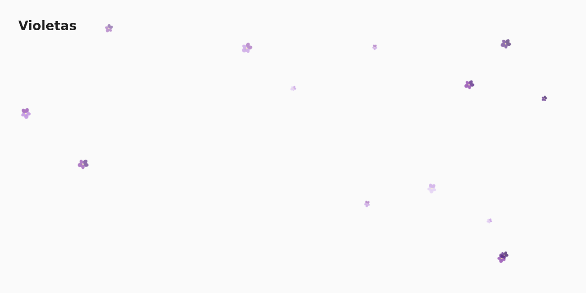

# Violetas

*[Leer en español (resumen)](README.es.md)*

Falling violets on every Home Assistant dashboard, for every user, behind one switch.



Violetas is a small custom integration. Add it once and you get a `switch.violetas` entity: while it is
on, a light overlay of falling violets shows on top of every dashboard, in every browser and in the
companion apps. It does not take any space in your layouts and never blocks taps or clicks.

Violets (*violetas*) bloom in central Chile from mid October to the end of November. This
integration started as a seasonal decoration for those weeks, but you can turn it on whenever you like.

## Requirements

Home Assistant 2026.2 or newer. The integration's own icon shows in Home Assistant 2026.3 and newer.

## Installation

### HACS (custom repository)

1. Open HACS (*Marketplace* in recent Home Assistant versions) → ⋮ → **Custom repositories**.
2. Add `https://github.com/claudiojara/ha-violetas` with category **Integration**.
3. Install **Violetas**. Restart Home Assistant if asked to.
4. **Settings → Devices & services → Add integration → Violetas**.

That is all: no YAML, no helper to create, no dashboard resource to add. The switch starts **on**,
so the violets appear right away (reload open browser tabs once).

### Manual

Copy `custom_components/violetas` into your `config/custom_components/` folder, restart Home
Assistant and add the integration as in step 4.

## Usage

| Entity | What it does |
|---|---|
| `switch.violetas` | On: violets on every dashboard for every user. Off: nothing. Its state survives restarts. |

The switch has the current options as attributes (`count`, `speed`, `opacity`). You can rename its
entity ID: the overlay follows the switch, not its name.

### Options

**Settings → Devices & services → Violetas → Configure**:

| Option | Default | Range |
|---|---|---|
| Number of violets | 25 | 1–80 |
| Speed | Normal | Slow, Normal, Fast |
| Opacity | 0.9 | 0.1–1 |

Changes apply immediately on open dashboards, without restarting Home Assistant.

### Seasonal automation

Turn the violets on for the Chilean violet season (October 15 – November 30) and off the rest of
the year:

```yaml
alias: Violet season
triggers:
  - trigger: time
    at: "00:00:00"
  - trigger: homeassistant
    event: start
actions:
  - action: >-
      {% set md = now().strftime('%m-%d') %}
      switch.turn_{{ 'on' if '10-15' <= md <= '11-30' else 'off' }}
    target:
      entity_id: switch.violetas
mode: single
```

### Only in one view (optional)

The integration also provides a card, `custom:violet-fall-card`, for a single view instead of every
dashboard:

```yaml
type: custom:violet-fall-card
count: 25        # 1–80
speed: normal    # slow | normal | fast
opacity: 0.9     # 0–1
colors:          # optional, dark → light
  - "#3f1a66"
  - "#5b2a86"
  - "#8e44ad"
  - "#b57edc"
  - "#d6b8f0"
```

While `switch.violetas` is on, the card draws nothing, so you never get double flowers.

## Accessibility and performance

- If the device asks for reduced motion (`prefers-reduced-motion: reduce`, for example *Reduce
  motion* on iOS or *Remove animations* on Android), no violets are drawn at all.
- Animations pause while the tab or app is in the background.
- Pure CSS animations, no canvas and no timers while running. On an old wall tablet, lower the
  number of violets.
- The overlay uses `pointer-events: none`: everything underneath stays clickable.

## How it works

- The integration serves its script at `/violetas/violetas.js` and adds it to every frontend page with
  `frontend.add_extra_js_url` (versioned URL, so browsers pick up updates). It is not a Lovelace
  resource, so it works for non-admin users and on every dashboard.
- The script subscribes to the websocket command `violetas/subscribe` (allowed for every logged-in
  user). The integration answers with a snapshot (`enabled`, `count`, `speed`, `opacity`) and sends a
  new one whenever the switch or the options change. After Home Assistant restarts, the script
  subscribes again on its own; if that keeps failing, it hides the violets until it works.
- Reloading the integration or renaming the switch does not redraw the violets: the integration
  waits 3 seconds before reporting the switch as gone. Disabling the switch entity or unloading the
  integration hides them after those 3 seconds.
- The script shares one page-wide flag (`window.__violetFallGlobal`) with any other copy of the
  `violet-fall-card` script, so two copies never draw two overlays.
- No network access, no cloud, no data leaves your Home Assistant.

## Uninstall

1. **Settings → Devices & services → Violetas → ⋮ → Delete**. The violets disappear from open
   dashboards right away.
2. Remove the repository in HACS (or delete `config/custom_components/violetas`) and restart Home
   Assistant.
3. Remove any `custom:violet-fall-card` cards from your dashboards.

## Development

Python 3.14 (3.13.2 or newer) and Node.js 24.

```sh
pip install -r requirements_test.txt       # Home Assistant 2026.2 test harness
pytest                                     # integration tests
node --test tests/js/*.test.mjs            # script logic
npm install && npx playwright install chromium
node verify/browser.mjs                    # headless DOM checks against a fake connection
art/render.sh                              # brand PNGs from the SVG sources (ImageMagick)
```

## License

MIT © Claudio Jara. The violet artwork is original and under the same license.
